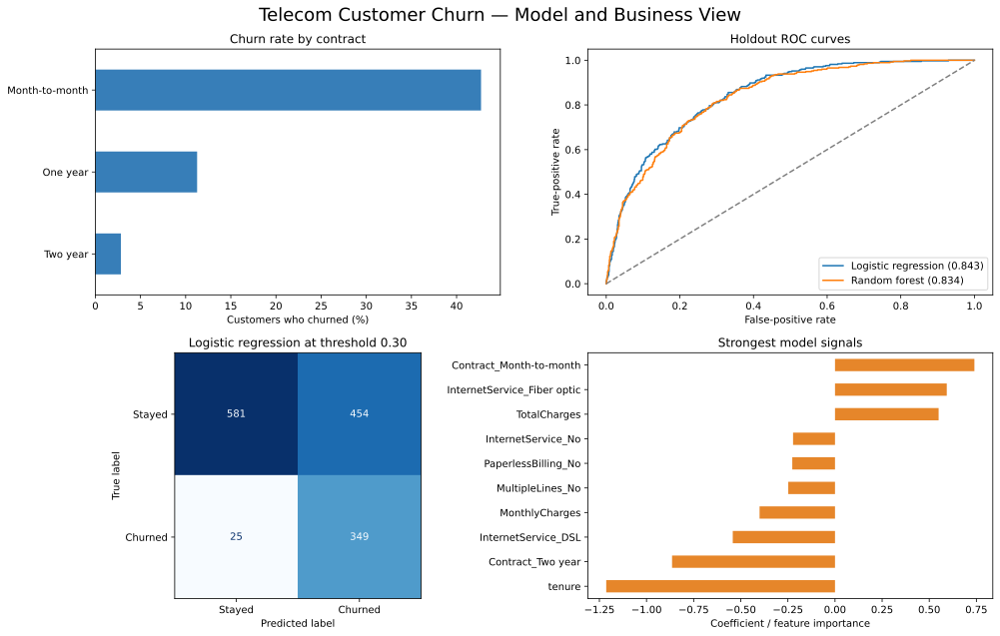

# Telecom Customer Churn Prediction

[](https://github.com/MUmairSarwar/customer-churn-prediction/actions/workflows/tests.yml)

Which customers should a telecom company contact before they cancel? This project fits two classifiers to IBM's public Telco Customer Churn sample and then picks the decision threshold from an explicit cost assumption instead of using the default 0.5.



## Approach

The data has 7,043 customers and 21 columns (demographics, services, contract, billing and the churn label). `TotalCharges` is stored as text and is blank for a few customers; it is converted to numeric and the blanks are imputed with the median. The `customerID` column is dropped before modelling.

The pipeline in [`src/pipeline.py`](src/pipeline.py) does the following:

1. Splits the data into train, validation and holdout sets (60/20/20, stratified on churn, `random_state=42`).
2. Fits two models with class weighting, both behind the same preprocessing (median/most-frequent imputation, standard scaling for numeric columns, one-hot encoding for categorical columns):
   - logistic regression
   - random forest (250 trees, `min_samples_leaf=3`)
3. Keeps the model with the higher validation ROC AUC.
4. Chooses the threshold $t$ on the validation set by minimising

   $$\text{cost}(t) = 5 \cdot \text{FN}(t) + 1 \cdot \text{FP}(t)$$

   over $t \in \{0.10, 0.11, \dots, 0.80\}$. The 5:1 ratio says that missing a churner is assumed to cost five times as much as contacting a customer who would have stayed. It is my assumption, not a figure from a real company.
5. Reports ROC AUC, PR AUC, Brier score, precision, recall and F1 on the holdout set, which is not used for any choice above.

## Results

On validation data the two models were close (ROC AUC 0.836 for logistic regression, 0.832 for the random forest), so the simpler logistic regression was selected. Holdout results at the selected threshold of 0.30:

| Metric | Holdout |
|---|---:|
| ROC AUC | 0.843 |
| PR AUC | 0.633 |
| Brier score | 0.168 |
| Recall | 93.3% |
| Precision | 43.5% |
| F1 | 0.593 |

The overall churn rate is 26.5%. The low threshold catches almost all churners, at the price of contacting many customers who would have stayed; that is the trade-off the 5:1 cost ratio asks for. A different cost ratio gives a different threshold.

The exact numbers are in [`reports/model_metrics.json`](reports/model_metrics.json) and the validation comparison in [`reports/model_comparison.csv`](reports/model_comparison.csv). The "strongest model signals" panel of the dashboard shows logistic-regression coefficients on scaled and one-hot encoded features. They show what the model relies on, not causal effects.

## Run locally

The dataset is not stored in the repository, so download it first:

```bash
python -m venv .venv
source .venv/bin/activate
pip install -r requirements.txt
python -m src.download_data   # saves data/telco_customer_churn.csv
python -m pytest -q
python -m src.pipeline        # rewrites reports/ and the dashboard figure
```

The unit tests use small synthetic frames and do not need the dataset.

## Project structure

```text
src/churn.py           data loading, model definitions, cost-based threshold, metrics
src/pipeline.py        splits, training, model selection, reports and dashboard
src/download_data.py   fetches the CSV from IBM's GitHub repository
tests/                 unit tests for loading, threshold search and metrics
reports/               metrics, model comparison, business summary, dashboard
```

## Data and limitations

The data is the Telco Customer Churn sample from IBM's [`telco-customer-churn-on-icp4d`](https://github.com/IBM/telco-customer-churn-on-icp4d/tree/master/data) repository. It is a public teaching dataset with synthetic customer IDs. IBM's repository has contained it since at least September 2019, but that does not say when the underlying records were collected.

- The results describe one static sample, not a current customer base.
- Relationships the model finds are associations. They do not show what would happen if a customer were offered a retention deal.
- Only one random split is used, so there is no estimate of how much the metrics vary between splits.
- Neither model was tuned beyond the settings listed above.
- Using this in practice would need current data, a measured cost of contacting and losing customers, a fairness review and a controlled retention experiment.

## History

An earlier version (December 2025) was a notebook on synthetic data. In August 2026 I rebuilt the project around the IBM sample with separate validation and holdout sets, the cost-based threshold, generated reports and tests. All results above come from the rebuilt version.

## Author

Muhammad Umair Sarwar, M.Sc. Mathematics (Mathematics in Data Science), TU Darmstadt. Other projects are listed on my [GitHub profile](https://github.com/MUmairSarwar).

Code is released under the [MIT License](LICENSE).
